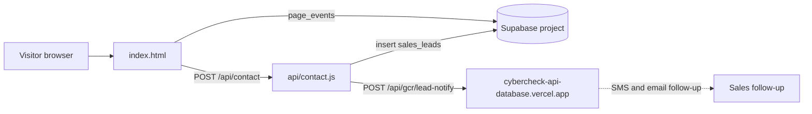

# LAUNCH-GCR-CYBERCHECK

One-page marketing site for Gulf Coast Radar / CyberCheck with a lead-capture form (static HTML plus one Vercel function).

## What it is

A landing page titled "Gulf Coast Radar - The All-In-One Platform for Gulf Coast Businesses", with privacy, terms and SMS-terms pages. A visitor fills in a form; the lead is saved and a follow-up notification is requested from another API.

## How it works

- `index.html`: the whole landing page with inline CSS and JS. The two forms POST to `/api/contact`.
- `api/contact.js`: Vercel serverless function. Requires a phone or email, inserts a row into the Supabase table `sales_leads`, then calls `${CYBERCHECK_API_URL}/api/gcr/lead-notify` without waiting. The default URL is `https://cybercheck-api-database.vercel.app`.
- `index.html` also records page views into a Supabase table `page_events` from the browser.
- `privacy.html`, `terms.html`, `sms-terms.html`: legal pages.
- `vercel.json`: limits the function to 128 MB and 10 seconds. `package.json` depends only on `@supabase/supabase-js`.
- The Supabase project used is not the live platform database, and the function writes to it directly instead of going through `gcr-api-clean`.

## Run it

```bash
npm install
vercel dev            # or deploy to Vercel; the static page also opens on any static server
```

Env var names: `SUPABASE_SERVICE_KEY`, `CYBERCHECK_API_URL` (optional). Without them the form will not save leads. Not run as part of this review.

## Status

In use: a small, complete, deployable lead-capture site, last changed April 2026 (single commit).

## Where it fits



## Related repos

- `cybercheck-api-database`: receives the lead-notify call.
- `launching-gcr-json-load`, `gcr-links`: likely share landing-page content with the GCR front ends (not compared file by file).
- `a-next-gent`: lists this repo in its inventory CSV only.
